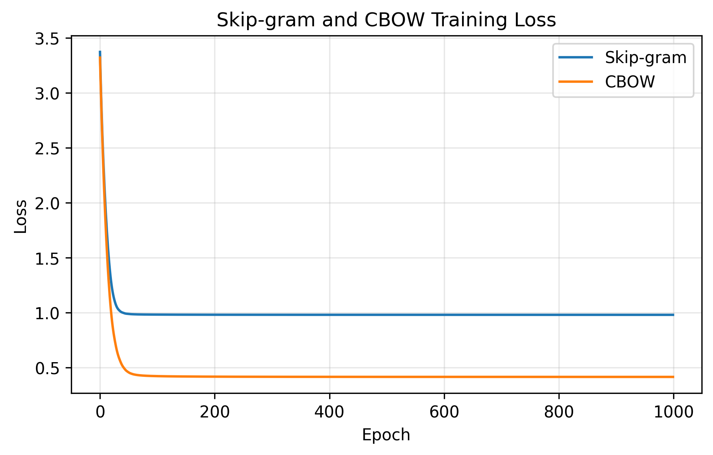

# NLP 实验二：词向量学习与 CBOW / Skip-gram 对比

自然语言处理课程实验项目，包含原实验的 LaTeX 报告、18 张运行截图，以及可以从头运行的 PyTorch 扩展实验。

## 直接查看

- [扩展实验 Notebook：代码和已保存的运行结果](NLP_exp2_CBOW_SkipGram.ipynb)
- [课程实验报告 PDF](report/NLP_exp2_report.pdf)
- [报告 LaTeX 源码](report/NLP_exp2_report.tex)
- [扩展实验词对相似度 CSV](results/extra_cbow_skipgram_comparison.csv)
- [运行环境与训练参数](results/run_info.json)

## 两部分内容的关系

| 文件 | 内容与范围 |
|:---:|:---:|
| `report/` | 原课程实验：独热表示、共现矩阵与 SVD、修改语料前后比较、Skip-gram 训练、词向量相似度、PCA 可视化、CBOW 样本构造及理论讨论。 |
| `NLP_exp2_CBOW_SkipGram.ipynb` | 扩展实验：在相同的 8 句语料上训练 Skip-gram 和 CBOW，并比较损失曲线、词对相似度及相似词。 |

报告按原实验过程保留，CBOW 在其中只完成样本构造；扩展 Notebook 进一步完成 CBOW 训练。Notebook 不包含报告中共现矩阵 / SVD 的代码，不能用它重现报告的全部章节。报告中的 18 张截图保持原样，`results/` 则来自本次重新运行扩展 Notebook。

两部分均使用完整 Softmax。负采样、层次 Softmax 与哈夫曼树为原理讨论，本项目没有相应算法实现。

## 项目结构

```text
.
├── README.md
├── requirements.txt
├── .gitignore
├── .gitattributes
├── NLP_exp2_CBOW_SkipGram.ipynb
├── report/
│   ├── NLP_exp2_report.pdf
│   ├── NLP_exp2_report.tex
│   ├── README.md
│   ├── figures_manifest.json
│   └── figures/                  # 原实验的 18 张截图
└── results/
    ├── extra_cbow_skipgram_loss.png
    ├── extra_cbow_skipgram_comparison.csv
    ├── execution_log.txt
    └── run_info.json
```

## 运行 Notebook

建议使用 Python 3.10 或更高版本。在项目根目录打开终端：

```bash
python -m venv .venv
```

激活环境：

```powershell
# Windows PowerShell
.\.venv\Scripts\Activate.ps1
```

```bash
# macOS / Linux
source .venv/bin/activate
```

安装依赖并启动 Jupyter：

```bash
python -m pip install -r requirements.txt
python -m ipykernel install --user --name nlp-exp2-github --display-name "Python (NLP实验2)"
python -m jupyterlab .
```

打开 `NLP_exp2_CBOW_SkipGram.ipynb`，选择 `Python (NLP实验2)` 内核，再选择“重启内核并运行所有单元格”。Notebook 位于仓库根目录，重新运行时会更新同目录下 `results/` 的曲线和 CSV 文件。Notebook 已保存输出，GitHub 上可直接查看，无需先运行。

实验使用人工空格分词的小语料，不需要下载数据集、预训练模型或 jieba 词典。训练在 CPU 上完成。

## 训练设置

| 项目 | 设置 |
|:---:|:---:|
| 语料 | 8 个句子，37 个词次，23 个词 |
| 上下文窗口 | 左右各 1 个词，逐句构造样本 |
| Skip-gram 样本 | 58 个，中心词预测上下文词 |
| CBOW 样本 | 37 个，上下文预测中心词 |
| 词向量维度 | 10 |
| 输出层 | 线性层 + 交叉熵，完整 Softmax |
| 优化器 / 学习率 | Adam / 0.03 |
| 训练轮数 / 随机种子 | 1000 / 42 |
| CBOW 上下文合并 | 带掩码的平均，填充位置不参与计算 |

## 本次运行结果

下表来自 `results/extra_cbow_skipgram_comparison.csv`，均为余弦相似度：

| 词对 | Skip-gram | CBOW |
|:---:|:---:|:---:|
| 猫—狗 | 0.7484 | 0.7133 |
| 天空—飞机 | 0.5342 | -0.0305 |
| 猫—飞机 | 0.3546 | 0.2399 |
| 鱼—水中 | -0.3721 | -0.5928 |



两个模型的预测目标和训练样本数量不同，不能只按损失绝对值判断词向量质量。小语料中的相似词也不必然符合日常语义。随机种子固定为 42，但不同 PyTorch 版本或平台仍可能产生数值差异；实际核验环境见 `results/run_info.json`。

## 编译报告

安装 TeX Live，并确保系统中有宋体（SimSun）、黑体（SimHei）和 Times New Roman。进入 `report/` 后使用 XeLaTeX 连续编译两次：

```bash
cd report
xelatex -interaction=nonstopmode -halt-on-error NLP_exp2_report.tex
xelatex -interaction=nonstopmode -halt-on-error NLP_exp2_report.tex
```

也可以在 TeXstudio 中打开源码并选择 XeLaTeX。无需开启 `shell-escape`。PDF 已提供，查看报告不需要安装 LaTeX。正文表格和内容居中、表头加粗；开头为标题和目录，页眉无文字和横线，页脚保留页码。详细字体排版说明见 [报告说明](report/README.md)。

## 上传 GitHub

1. 解压项目包，在 GitHub 新建仓库。
2. 选择 **Add file → Upload files**，上传本项目文件夹内的文件及 `report/`、`results/` 两个目录，保留上述相对目录结构。
3. 确认 `README.md` 位于仓库根目录，提交后即可在首页查看说明，并打开 Notebook 和 PDF。

不要仅把 ZIP 压缩包作为唯一仓库文件上传，否则 GitHub 无法直接展示内部的 README 和 Notebook。`.gitignore`、`.gitattributes` 为隐藏文件，使用 Git 上传时会正常纳入项目；网页版上传时可检查它们是否已选择。

## 参考资料

- 教师提供的《NLP 实验二：词向量》实验设计材料。
- [Efficient Estimation of Word Representations in Vector Space](https://arxiv.org/abs/1301.3781)
- [Distributed Representations of Words and Phrases and their Compositionality](https://arxiv.org/abs/1310.4546)
- [GloVe: Global Vectors for Word Representation](https://aclanthology.org/D14-1162/)
- [Deep Contextualized Word Representations](https://aclanthology.org/N18-1202/)
